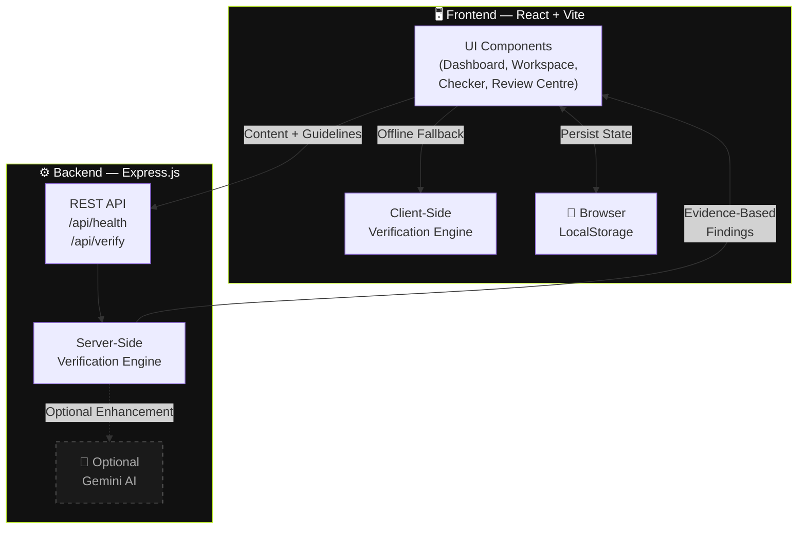

<div align="center">

# 🛡️ CREDENCE AI

### **Confidence in Every Brand Claim**

An intelligent brand-governance platform that verifies every marketing claim, price, buzzword, and voice attribute against an authoritative **Brand Truth Ledger** — anchoring every finding in certified evidence, not AI hallucination.

&nbsp;

[](https://react.dev/)
[](https://vitejs.dev/)
[](https://tailwindcss.com/)
[](https://expressjs.com/)
[](https://nodejs.org/)
[](https://developer.mozilla.org/en-US/docs/Web/JavaScript)

&nbsp;

</div>

---

## 📑 Table of Contents

| | Section | | Section |
|---|---|---|---|
| 🔍 | [About Credence AI](#-about-credence-ai) | 🏗️ | [System Architecture](#%EF%B8%8F-system-architecture) |
| ❗ | [Problem Statement](#-problem-statement) | 🧰 | [Technology Stack](#-technology-stack) |
| 💡 | [Our Solution](#-our-solution) | 🚀 | [Getting Started](#-getting-started) |
| ⚡ | [Core Features](#-core-features) | 🔐 | [Environment Variables](#-environment-variables) |
| 📸 | [Product Screenshots](#-product-screenshots) | 💻 | [Running Locally](#-running-locally) |
| 🔄 | [How It Works](#-how-it-works) | 🧪 | [Verification Examples](#-verification-examples) |
| 🧭 | [Round 3 Roadmap](#-round-3-roadmap) | ☁️ | [Deployment](#%EF%B8%8F-deployment) |
| ⚠️ | [Limitations](#%EF%B8%8F-limitations) | 🤖 | [AI Development Disclosure](#-ai-development-disclosure) |
| 📄 | [Project Information](#-project-information) | | |

---

## 🔍 About Credence AI

**Credence AI** is a brand compliance and content verification platform built for marketing teams, brand managers, and compliance officers. It acts as a pre-publication checkpoint that catches pricing errors, prohibited terminology, unsupported claims, and tone violations — all backed by traceable evidence from a versioned **Brand Truth Ledger**.

Unlike black-box AI content filters, Credence AI anchors every single finding to a specific fact record with certified source citations. When it flags your copy, it tells you *exactly why* and *exactly where the approved truth lives*.

---

## ❗ Problem Statement

Organizations publish marketing copy through dozens of employees, external agencies, and generative AI tools. This decentralized publishing creates severe brand and compliance hazards:

| Hazard | Example | Business Risk |
|:---|:---|:---|
| 🏷️ **Outdated Pricing** | Publishing ₹999 after a revision to ₹1,199 | Customer disputes, refund liability |
| 🚫 **Prohibited Terminology** | Using *"cheap"* instead of approved *"affordable"* | Brand erosion, positioning damage |
| ⚠️ **Unsupported Claims** | *"Guaranteed to double muscle recovery"* | Regulatory penalties, legal exposure |
| 🗣️ **Inconsistent Voice** | Casual slang conflicting with professional brand tone | Trust degradation, audience confusion |

**There is no systematic, evidence-based checkpoint between content creation and publication.**

---

## 💡 Our Solution

Credence AI introduces an **evidence-first verification layer** between content creation and publication:

1. **Define** your brand truth — prices, approved terms, claims, voice — in a structured, versioned ledger.
2. **Submit** any marketing copy for pre-flight verification.
3. **Receive** evidence-backed findings with specific policy citations — not vague AI scores.
4. **Apply** suggested corrections that preserve the creator's original intent.
5. **Approve** through a formal human review gate before publication.

> Every finding is anchored to a **Fact ID** with a certified source citation. Nothing is hallucinated.

---

## ⚡ Core Features

<div align="center">

### ✅ Implemented Features

</div>

| Feature | Description |
|:---|:---|
| 📊 **Executive Dashboard** | Real-time compliance metrics — total audits, issues caught, pending approvals, approved/rejected counts, and a live activity feed |
| 🏢 **Brand Workspace** | Define brand profile, tone of voice, approved/prohibited terminology, and product pricing catalog |
| 📖 **Brand Truth Ledger** | Versioned fact repository across 5 categories with approved values, superseded values, certified sources, and full revision audit logs |
| ✏️ **Content Checker** | Pre-flight verification for social media, ads, website copy, emails, and packaging with 5 evidentiary statuses |
| 🔧 **Correction Assistant** | Side-by-side comparison of flagged phrases vs. drop-in corrections, one-click copy, and **Replace in Editor** workflow |
| 👤 **Human Review Centre** | Formal approval/rejection gate with reviewer metadata, timestamped notes, and append-only audit trail |
| 📜 **Review History** | Searchable archive with status filters and findings quick-view modal |
| 📈 **Governance Insights** | Analytics derived from actual audit records — common violations, prohibited word frequencies, high-friction guidelines |
| 🎯 **NovaFit Demo** | Pre-loaded demonstration brand with 1-click test copy that verifies all 5 target issues |
| 🔒 **Zero-Key Security** | No API keys on client; optional Gemini integration on the backend with automatic fallback to the deterministic rule engine |
| 💾 **Persistent Storage** | Browser LocalStorage persistence with full demo reset capability |

<div align="center">

### 🗺️ Planned Features (Round 3)

</div>

| Feature | Status |
|:---|:---|
| 🖼️ Multimodal Visual & Logo Verification | *Roadmap* |
| 🏢 Multi-Tenant Enterprise Database | *Roadmap* |
| 🔐 Role-Based Access Control (RBAC) & SSO | *Roadmap* |

---

## 📸 Product Screenshots

> **📷 Screenshots needed** — The repository does not yet contain UI screenshots. To complete this section, please capture and save the following images to a `docs/screenshots/` folder:

| # | Screen | Suggested Filename | What to Capture |
|:---:|:---|:---|:---|
| 1 | Dashboard | `dashboard.png` | Full dashboard with compliance metrics, health score, and activity feed |
| 2 | Brand Workspace | `workspace.png` | Brand profile editor with terminology tags and product pricing |
| 3 | Brand Truth Ledger | `ledger.png` | Truth records table showing categories, approved values, and sources |
| 4 | Content Checker — Incorrect | `checker-fail.png` | Verification results showing detected issues with the demo copy |
| 5 | Content Checker — Corrected | `checker-pass.png` | 100% compliance score after applying corrections |
| 6 | Human Review Centre | `review-centre.png` | Review queue with approve/reject actions |
| 7 | Governance Insights | `insights.png` | Analytics charts showing violation patterns |
| 8 | Mobile Navigation | `mobile-nav.png` | Mobile view with hamburger menu and slide-in sidebar |

<!--
After adding screenshots, uncomment and update the gallery below:

<div align="center">

<br><em>Executive Governance Dashboard</em>
</div>
-->

---

## 🔄 How It Works

```mermaid
flowchart LR
    A["📝 Brand Guidelines\nDefined in Workspace"] --> B["✏️ Content Submission\nMarketing Copy Input"]
    B --> C["🔍 Verification Engine\nRule-Based Analysis"]
    C --> D["📋 Evidence-Based Findings\nAnchored to Truth Ledger"]
    D --> E["🔧 Suggested Corrections\nDrop-in Replacements"]
    E --> F["👤 Human Approval\nReview Centre Gate"]
    F --> G["✅ Approved for\nPublication"]

    style A fill:#1a1a1a,stroke:#C6F432,color:#ffffff
    style B fill:#1a1a1a,stroke:#C6F432,color:#ffffff
    style C fill:#1a1a1a,stroke:#C6F432,color:#ffffff
    style D fill:#1a1a1a,stroke:#C6F432,color:#ffffff
    style E fill:#1a1a1a,stroke:#C6F432,color:#ffffff
    style F fill:#1a1a1a,stroke:#C6F432,color:#ffffff
    style G fill:#0B0B0C,stroke:#C6F432,color:#C6F432,stroke-width:3px
```



### Verification Workflow

1. **Define Brand Truth** — Configure approved prices, terminology, claims, and tone in the Brand Workspace & Truth Ledger.
2. **Submit Content** — Paste or type marketing copy into the Content Checker. Select the content type (social media, ad, email, etc.).
3. **Automated Verification** — The deterministic rule engine checks the copy against the Truth Ledger across 8 distinct compliance dimensions.
4. **Evidence-Based Results** — Each finding is classified with one of 5 evidentiary statuses and linked to a specific Fact ID with its certified source.
5. **Apply Corrections** — Review suggested fixes and apply them individually or all at once with **Replace in Editor**.
6. **Human Review** — Submit verified content to the Review Centre for formal approval before publication.

### Evidentiary Status Classification

| Status | Meaning |
|:---|:---|
| `VERIFIED` ✅ | Directly corroborated by the Truth Ledger |
| `CONTRADICTED` ❌ | Directly clashes with approved facts or prices |
| `OUTDATED` 🕐 | Matches superseded prices or obsolete claims |
| `UNVERIFIED` ⚠️ | Assertive claims lacking substantiation |
| `UNCERTAIN` ❓ | Borderline tone, slang, or missing attribution |

---

## 🏗️ System Architecture



**Key Architecture Decisions:**
- **Deterministic First:** The core rule engine is 100% JavaScript — no external AI dependency required for accurate verification.
- **Optional AI Enhancement:** Google Gemini API can be enabled on the backend for nuanced semantic analysis, with automatic fallback to the rule engine if the API is unavailable.
- **Zero Client-Side Secrets:** API keys are never exposed to the browser. All AI calls route through the Express backend.
- **Offline Capable:** The client-side rule engine provides full verification capability even when the backend is unreachable.

---

## 🧰 Technology Stack

<div align="center">

| Layer | Technology | Version | Purpose |
|:---:|:---|:---:|:---|
| ⚛️ | **React** | 18.3 | Component-based UI framework |
| ⚡ | **Vite** | 6.1 | Build tool and dev server |
| 🎨 | **Tailwind CSS** | 3.4 | Utility-first CSS framework |
| 🎯 | **Lucide React** | 0.475 | Icon library |
| 🖥️ | **Express.js** | 4.21 | Backend REST API server |
| 🟢 | **Node.js** | ≥ 18 | JavaScript runtime |
| 🔑 | **dotenv** | 16.4 | Environment variable management |
| 🌐 | **CORS** | 2.8 | Cross-origin request handling |
| 💾 | **LocalStorage** | — | Browser-based data persistence |
| 🤖 | **Google Gemini** | *Optional* | AI-enhanced semantic analysis |

</div>

### Design System

| Token | Hex | Role |
|:---|:---|:---|
| ⬛ Midnight Black | `#0B0B0C` | Navigation, panels, contrast backgrounds |
| ⬜ Pure White | `#FFFFFF` | Workspace canvases, forms, data tables |
| 🟩 Signature Lime | `#C6F432` | Actions, scores, active indicators, focus highlights |

---

## 🚀 Getting Started

### Prerequisites

- **Node.js** v18 or higher (tested on v24.x)
- **npm** (included with Node.js)
- **Git** (to clone the repository)

### Clone the Repository

```bash
git clone https://github.com/YOUR_USERNAME/credence-ai.git
cd credence-ai
```

---

## 🔐 Environment Variables

Create `.env` files from the provided examples:

**`client/.env`**
```bash
# Local development
VITE_API_BASE_URL=http://localhost:5000

# Production — set in your deployment dashboard (e.g., Vercel)
# VITE_API_BASE_URL=https://your-render-service.onrender.com
```

**`server/.env`**
```bash
PORT=5000
HOST=0.0.0.0
CLIENT_URL=http://localhost:3000

# Optional — leave blank to use the deterministic rule engine
GEMINI_API_KEY=
```

| Variable | Location | Required | Description |
|:---|:---:|:---:|:---|
| `VITE_API_BASE_URL` | client | Yes | Backend API endpoint URL |
| `PORT` | server | Yes | Express server port (default: `5000`) |
| `HOST` | server | No | Bind address (default: `0.0.0.0`) |
| `CLIENT_URL` | server | No | Allowed CORS origin (`*` for development) |
| `GEMINI_API_KEY` | server | No | Google Gemini API key for AI enhancement |

> ⚠️ **Never commit real `.env` files.** Use `.env.example` as a template. The `.gitignore` is pre-configured to exclude `.env` files.

---

## 💻 Running Locally

### 1. Install Dependencies

```bash
# Install client dependencies
cd client
npm install

# Install server dependencies
cd ../server
npm install
cd ..
```

### 2. Start the Backend

```bash
cd server
npm start
```

The server starts at `http://localhost:5000`. Verify with:

```bash
curl http://localhost:5000/api/health
```

### 3. Start the Frontend

In a separate terminal:

```bash
cd client
npm run dev
```

Open your browser at **`http://localhost:3000`** (or the port shown in your terminal).

---

## 🧪 Verification Examples

### Demo Walkthrough

Credence AI ships with a pre-loaded demonstration brand: **NovaFit Nutrition**.

1. Navigate to **Content Checker** from the sidebar.
2. Click **"Load Demonstration Copy"** to load the test copy:
   > *"Yo guys! Get our cheap Protein Blend for just INR 999. Guaranteed to double your muscle recovery!"*
3. Click **"Run Verification"** — observe 5 detected compliance issues:

| # | Issue | Status | Evidence |
|:---:|:---|:---:|:---|
| 1 | *"Yo guys"* — informal slang | `UNCERTAIN` | Violates Professional, Friendly, Trustworthy tone |
| 2 | *"cheap"* — prohibited term | `CONTRADICTED` | Brand Voice policy; use *"Affordable"* |
| 3 | *"INR 999"* — outdated price | `OUTDATED` | Revised to approved price of ₹1,199 |
| 4 | *"Guaranteed to double..."* — unsupported claim | `UNVERIFIED` | No clinical substantiation |
| 5 | Missing brand attribution | `UNCERTAIN` | Master brand name not present |

4. Click **"Replace in Editor"** — the copy transforms to:
   > *"Discover NovaFit Protein Blend at its approved price of ₹1,199. Designed to support normal muscle recovery."*
5. Click **"Run Verification"** again — **100% Brand Compliance Score** ✅
6. Submit to **Human Review Centre** → Approve → See metrics update in **Dashboard**.

### Testing the Verification Engine

Run the automated test suite:

```bash
cd server
npm run test:engine
```

<details>
<summary><strong>✅ Actual Test Output (click to expand)</strong></summary>

```
================================================================
       CREDENCE AI — COMPLETE FUNCTIONALITY & VERIFICATION AUDIT
================================================================

--- TEST SUITE 1: SCENARIO A (Incorrect Marketing Copy) ---
✅ PASS: Scenario A detected 5 findings (expected >= 4)
✅ PASS: Scenario A compliance score is 0% (expected < 50%)
✅ PASS: Detected prohibited word "cheap" with status CONTRADICTED
✅ PASS: Detected informal slang "Yo guys" violating Professional tone
✅ PASS: Detected outdated price INR 999 vs revised ₹1,199
✅ PASS: Detected unsupported guarantee "Guaranteed to double muscle recovery"
Suggested Clean Copy: "Discover NovaFit Protein Blend at its approved price of ₹1,199. Designed to support normal muscle recovery."
✅ PASS: Suggested clean copy replaces all violations with compliant brand text

--- TEST SUITE 2: SCENARIO B (Corrected Compliant Content) ---
✅ PASS: Scenario B clean copy score is 100% (expected 100%)
✅ PASS: Scenario B has 0 findings (detected: 0)

--- TEST SUITE 3: SCENARIO C (Dynamic Non-Demo User Copy) ---
✅ PASS: Scenario C dynamic scan found 4 issues
✅ PASS: Dynamically flagged price mismatch (INR 500 vs approved ₹1,199)
✅ PASS: Dynamically flagged prohibited term "cheap" in new copy

--- TEST SUITE 4: DYNAMIC BRAND TRUTH LEDGER MODIFICATIONS ---
✅ PASS: When price is updated to ₹1,499, previous price ₹1,199 is immediately flagged as OUTDATED
✅ PASS: New approved price ₹1,499 scores 100% (expected 100%)

================================================================
>>> ALL VERIFICATION ENGINE TESTS PASSED WITH 100% SUCCESS <<<
================================================================
```

</details>

---

## ☁️ Deployment

### Backend → Render

The project includes a pre-configured [`render.yaml`](render.yaml):

| Setting | Value |
|:---|:---|
| **Service Type** | Web Service |
| **Environment** | Node |
| **Root Directory** | `server` |
| **Build Command** | `npm install` |
| **Start Command** | `npm start` |
| **Plan** | Free |

**Environment variables to set in Render Dashboard:**

| Key | Value |
|:---|:---|
| `PORT` | `10000` (Render default) |
| `CLIENT_URL` | Your Vercel frontend URL (or `*`) |
| `GEMINI_API_KEY` | *(Optional)* Your Google Gemini API key |

### Frontend → Vercel

The project includes a pre-configured [`vercel.json`](vercel.json):

| Setting | Value |
|:---|:---|
| **Framework** | Vite |
| **Build Command** | `cd client && npm install && npm run build` |
| **Output Directory** | `client/dist` |
| **Rewrites** | `/*` → `/index.html` (SPA routing) |

**Environment variable to set in Vercel Dashboard:**

| Key | Value |
|:---|:---|
| `VITE_API_BASE_URL` | Your Render backend URL (e.g., `https://credence-ai-backend.onrender.com`) |

> ⚠️ **Never set `VITE_API_BASE_URL` to `localhost` in production.** Always use your actual Render service URL.

---

## 🧭 Round 3 Roadmap

| Pillar | Capabilities |
|:---|:---|
| 🖼️ **Multimodal Brand Intelligence** | Visual asset verification, logo clearspace compliance, OCR text extraction from images, WCAG color contrast auditing |
| 🔄 **Version-Aware Truth Ledger** | Reverse impact scanning when prices change, source expiry timers, git-like branching for brand mergers |
| 🏢 **Collaborative Enterprise Governance** | RBAC roles (copywriter, brand lead, legal counsel), threaded discussions on flagged issues, enterprise SSO, AI policy clarifier |

> Full details available in [`ROUND_3_ROADMAP.md`](ROUND_3_ROADMAP.md).

---

## ⚠️ Limitations

| Limitation | Detail |
|:---|:---|
| **Single-User Storage** | Data is stored in browser LocalStorage. Multi-tenant database is planned for Round 3. |
| **Text-Only Scope** | Currently verifies textual content only (social, ads, email, web copy). Visual/multimodal verification is on the roadmap. |
| **No Automated UI Tests** | The verification engine has full automated tests; end-to-end UI tests are not yet implemented. |
| **Optional AI Dependency** | Gemini AI integration requires a valid API key. Without it, the deterministic rule engine handles all verification. |
| **Demo Brand Only** | Ships with NovaFit Nutrition as the pre-loaded brand. Custom brands can be configured through the Brand Workspace. |

---

## 🤖 AI Development Disclosure

**Transparency Statement:**

- This project was developed with **AI-assisted coding tools** for code generation, debugging, and documentation.
- The **Gemini AI integration** is an optional backend feature for enhanced semantic analysis. It is **not required** for core verification functionality.
- The **deterministic rule engine** (core verification) is 100% JavaScript with zero AI dependency — it does not hallucinate, guess, or use probabilistic scoring.
- All verification findings are anchored to factual records in the Brand Truth Ledger with traceable evidence citations.
- No AI-generated content is presented to users as human-written content.

---

## 📄 Project Information

<div align="center">

**Built for Hackathon Submission**

| | |
|:---|:---|
| 📁 Project | CREDENCE AI |
| 📦 Version | 1.0.0 |
| 🧰 Stack | React · Vite · Tailwind CSS · Express · Node.js |
| 📚 Docs | [`DEPLOYMENT_GUIDE.md`](DEPLOYMENT_GUIDE.md) · [`FEATURE_STATUS.md`](FEATURE_STATUS.md) · [`ROUND_2_CHANGES.md`](ROUND_2_CHANGES.md) · [`ROUND_3_ROADMAP.md`](ROUND_3_ROADMAP.md) · [`FINAL_HANDOFF.md`](FINAL_HANDOFF.md) |

---

<sub>
<strong>CREDENCE AI</strong> — Confidence in Every Brand Claim<br>
Evidence-first brand governance for the modern enterprise.
</sub>

</div>
