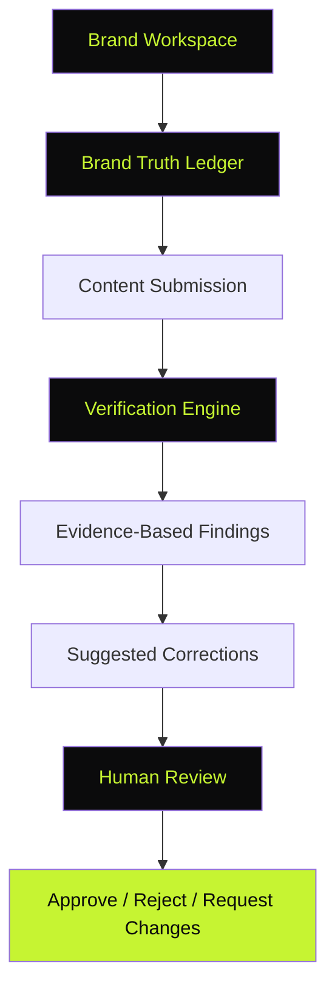
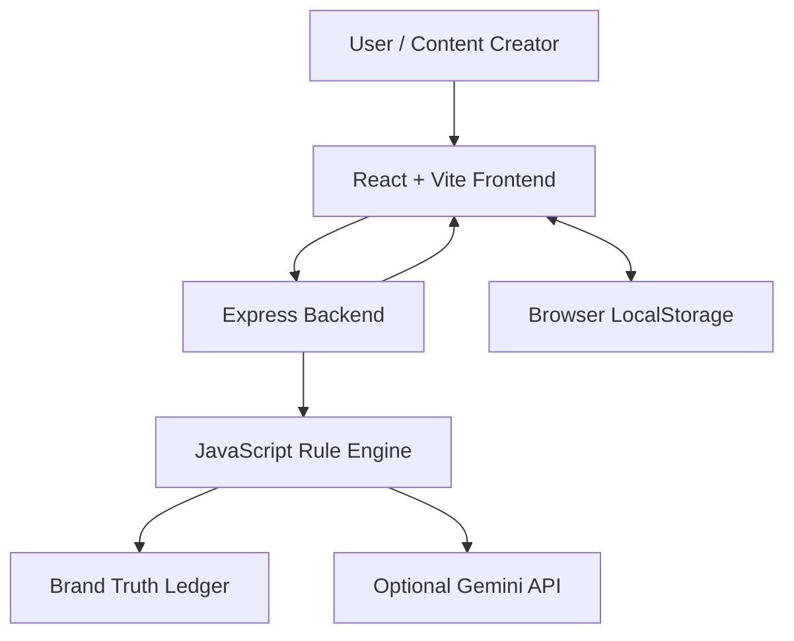

# CREDENCE AI
### Confidence in Every Brand Claim.

<p align="center">
  <strong>An Evidence-First Brand Governance Platform</strong>
  <br/>
  Verify marketing claims, protect brand identity, and maintain trustworthy communication before publication.
</p>

<p align="center">
  
  
  
</p>

<p align="center">
  
  
  
  
  
  
</p>

---

## ✦ Overview

Growing organisations publish content through multiple employees, creative agencies and generative AI tools. Maintaining a consistent brand identity across all these channels is difficult.

Incorrect product information, outdated pricing, prohibited terminology and unsupported promotional claims can damage brand credibility.

**Credence AI** addresses this problem through an evidence-first verification platform. It checks submitted marketing content against an authoritative Brand Truth Ledger, explains detected inconsistencies and suggests corrections while preserving the creator's original intention.

The platform combines automated verification with a human review and approval workflow.

## ◈ Table of Contents

- [Problem Statement](#-problem-statement)
- [Our Solution](#-our-solution)
- [Core Features](#-core-features)
- [Product Screenshots](#-product-screenshots)
- [How It Works](#-how-it-works)
- [System Architecture](#-system-architecture)
- [Technology Stack](#-technology-stack)
- [Getting Started](#-getting-started)
- [Verification Demonstration](#-verification-demonstration)
- [Security and Data](#-security-and-data)
- [Testing](#-testing)
- [Deployment](#-deployment)
- [Known Limitations](#-known-limitations)
- [Round 3 Roadmap](#-round-3-roadmap)
- [AI Development Disclosure](#-ai-development-disclosure)

---

## ◈ Problem Statement

Modern organisations distribute marketing communication across multiple teams and publishing channels. This creates several governance challenges:

| Challenge | Example |
|---|---|
| Outdated pricing | Publishing ₹999 after the approved price changes to ₹1,199 |
| Prohibited terminology | Using "cheap" instead of the approved word "affordable" |
| Unsupported claims | Promising to double muscle recovery without approved evidence |
| Inconsistent tone | Using casual slang in professional brand communication |
| Missing attribution | Publishing product content without required brand identification |

Traditional proofreading often misses these inconsistencies, particularly when content is generated or modified using AI.

## ◈ Our Solution

Credence AI introduces three central capabilities:

**01 — Brand Truth Ledger**

A structured repository of approved product facts, pricing, terminology, claims and source references.

**02 — Evidence-First Verification**

A verification engine that compares submitted content with approved brand information and explains the detected issues.

**03 — Human Governance**

A review and approval workflow that keeps authorised human decisions at the centre of publication.

---

## ◈ Core Features

### 01. Executive Governance Dashboard
- Content review statistics.
- Detected issue counts.
- Pending approval overview.
- Approved and rejected content.
- Recent review activity.

### 02. Brand Workspace
- Brand profile and communication style.
- Approved terminology management.
- Prohibited terminology management.
- Product information and pricing.
- Editable brand guidelines.

### 03. Brand Truth Ledger
- Structured approved facts and claims.
- Commercial pricing records.
- Product terminology.
- Clinical and efficacy claim records.
- Brand attribution and sourcing records.
- Previous values and version information.

### 04. Evidence-First Content Checker
- Social media and advertising content review.
- Website copy and email review.
- Prohibited terminology detection.
- Outdated pricing detection.
- Unsupported promotional claim detection.
- Tone and messaging checks.

### 05. Correction Assistant
- Original phrase and suggested correction comparison.
- Individual correction actions.
- One-click copy.
- Replace content in the editor.
- Re-run verification.

### 06. Human Review Centre
- Submit content for review.
- Approve submitted content.
- Reject content.
- Request changes.
- Record reviewer comments and decisions.

### 07. Governance Insights
- Frequently detected prohibited terms.
- Common violation categories.
- Recurring content issues.
- Insights calculated from saved review records.

---

## ◈ Product Screenshots

The following screenshots should be captured from the actual running application and added to the repository.

Create this folder:

`docs/screenshots/`

Add these images:

| Screenshot | Suggested filename |
|---|---|
| Dashboard | `dashboard.png` |
| Content Checker with findings | `content-checker.png` |
| Brand Truth Ledger | `truth-ledger.png` |
| Human Review Centre | `review-centre.png` |

<!-- Once the real screenshots have been added, insert them here using:
<p align="center">
  
</p>
-->

---

## ◈ How It Works

The central workflow connects approved brand information to content review and human approval.



### Verification Statuses

| Status | Meaning |
|---|---|
| `VERIFIED` | Matches an applicable approved record |
| `CONTRADICTED` | Conflicts with approved information |
| `OUTDATED` | Uses superseded information |
| `UNVERIFIED` | Adequate approved evidence was not found |
| `UNCERTAIN` | Requires further clarification or human review |

---

## ◈ Verification Demonstration

The prototype includes a fictional demonstration brand: **NovaFit Nutrition**.

**Approved brand information**

- Tone: Professional, Friendly, Trustworthy.
- Approved terminology: Affordable.
- Prohibited terminology: Cheap.
- Product: Protein Blend.
- Approved price: ₹1,199.
- Previous price: ₹999.
- Approved claim: Supports normal muscle recovery.

**Sample submitted content**

> Yo guys! Get our cheap Protein Blend for just INR 999. Guaranteed to double your muscle recovery!

The verification engine is designed to identify five findings in this bundled demonstration scenario, including informal tone, prohibited terminology, outdated pricing and an unsupported guarantee.

**Suggested corrected content**

> Discover NovaFit Protein Blend at its approved price of ₹1,199. Designed to support normal muscle recovery.

The bundled verification test reports that this corrected sample passes the configured demonstration rules.

---

## ◈ System Architecture

Credence AI uses a frontend, backend and verification-engine architecture.



The deterministic verification engine handles configured terminology and factual comparisons. Gemini is an optional backend integration for contextual analysis. The core rule-based workflow does not require an external AI API.

---

## ◈ Technology Stack

| Layer | Technology |
|---|---|
| Frontend | React 18, Vite 6 |
| Styling | Tailwind CSS 3 |
| Icons | Lucide React |
| Backend | Node.js, Express.js 4 |
| Verification | JavaScript rule engine |
| Optional AI | Google Gemini API |
| Persistence | Browser LocalStorage |
| Frontend hosting | Vercel |
| Backend hosting | Render |

---

## ◈ Getting Started

### Prerequisites

- Node.js 18 or later.
- npm.
- Git.

### 1. Clone the repository

```bash
git clone https://github.com/nirmalya-pro/credence-ai.git
cd credence-ai
```

### 2. Install backend dependencies

```bash
cd server
npm install
```

### 3. Configure the backend

Create a `.env` file inside `server/`.

```env
PORT=5000
HOST=0.0.0.0
CLIENT_URL=http://localhost:5173

# Optional: add a valid Gemini API key
GEMINI_API_KEY=
```

### 4. Start the backend

From the `server/` directory:

```bash
npm start
```

The local backend normally runs at:

`http://localhost:5000`

Health endpoint:

`http://localhost:5000/api/health`

### 5. Install frontend dependencies

Open a second terminal:

```bash
cd client
npm install
```

### 6. Configure the frontend

Create `client/.env`:

```env
VITE_API_BASE_URL=http://localhost:5000/api
```

### 7. Start the frontend

```bash
npm run dev
```

Open the local URL printed by Vite in your terminal. The default Vite development port is usually `5173`, unless configured differently.

---

## ◈ Testing

The project includes a deterministic verification audit script.

From the project root, run:

```bash
npm run test:engine
```

The documented demonstration test scenarios cover:

- Incorrect promotional copy.
- Corrected compliant copy.
- New user-submitted content.
- Changes to approved Brand Truth Ledger values.

The reported bundled engine tests include checks for prohibited terminology, price discrepancies, tone issues and unsupported claims.

Actual deployment and browser testing should be performed separately before release.

---

## ◈ Deployment

The project is prepared for separate frontend and backend hosting.

| Component | Platform |
|---|---|
| Source repository | GitHub |
| Backend API | Render |
| Frontend application | Vercel |

See [DEPLOYMENT_GUIDE.md](DEPLOYMENT_GUIDE.md) for project-specific configuration and deployment instructions.

**Important:** Set the deployed backend URL through the Vercel environment variable `VITE_API_BASE_URL`. Do not use localhost as the production API address.

---

## ◈ Security and Data

- Backend API credentials are stored in environment variables.
- Gemini integration is optional.
- Deterministic verification continues to work without an AI API key.
- Demo information uses fictional NovaFit Nutrition data.
- Browser LocalStorage is used for single-user prototype persistence.
- The application is a brand-governance tool, not a legal or regulatory certification service.

Never publish `.env` files, API keys, passwords or confidential brand information in this repository.

---

## ◈ Known Limitations

The current prototype has a deliberately limited scope.

- **Single-user persistence:** Data is stored in browser LocalStorage rather than a shared cloud database.
- **Text-based verification:** Advanced image, logo and visual asset scanning is not included in the current prototype.
- **Enterprise access control:** Full authentication, SSO and secured role-based access are not implemented.
- **Optional AI integration:** Contextual Gemini analysis requires a valid backend API configuration.

These limitations are considered in the future development roadmap.

---

## ◈ Round 3 Roadmap

### 01 — Multimodal Brand Intelligence
- Image and document review.
- Logo and visual consistency checks.
- Accessibility analysis.
- Approved brand asset comparison.

### 02 — Version-Aware Brand Truth Ledger
- Advanced fact versioning.
- Source tracking and expiry management.
- Identification of content affected by changed facts.

### 03 — Collaborative Brand Governance
- Role-based access control.
- Collaborative reviews and comments.
- Detailed audit trails.
- Advanced recurring-error analytics.
- Identification of unclear brand guidelines.

---

## ◈ AI Development Disclosure

Credence AI was developed with AI-assisted coding support using Google Antigravity.

The application uses React, Vite, Tailwind CSS, Node.js, Express.js and other open-source dependencies. Optional Gemini API integration is intended for contextual analysis, while the primary factual checks use a deterministic JavaScript verification engine.

AI-assisted development and external services should be considered when reviewing the source code and implementation.

---

<p align="center">
  <strong>CREDENCE AI</strong>
  <br/>
  <em>Confidence in Every Brand Claim.</em>
  <br/><br/>
  Built to help organisations communicate with consistency, evidence and trust.
  <br/><br/>
  <sub>CodeNexus India 2026 · Round 2 Prototype</sub>
</p>
